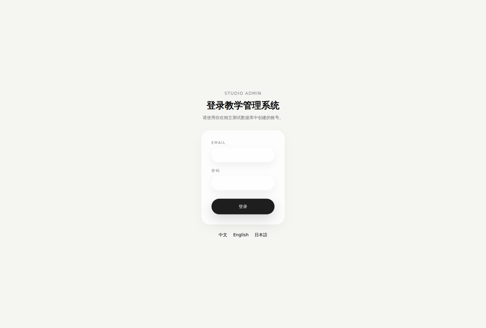
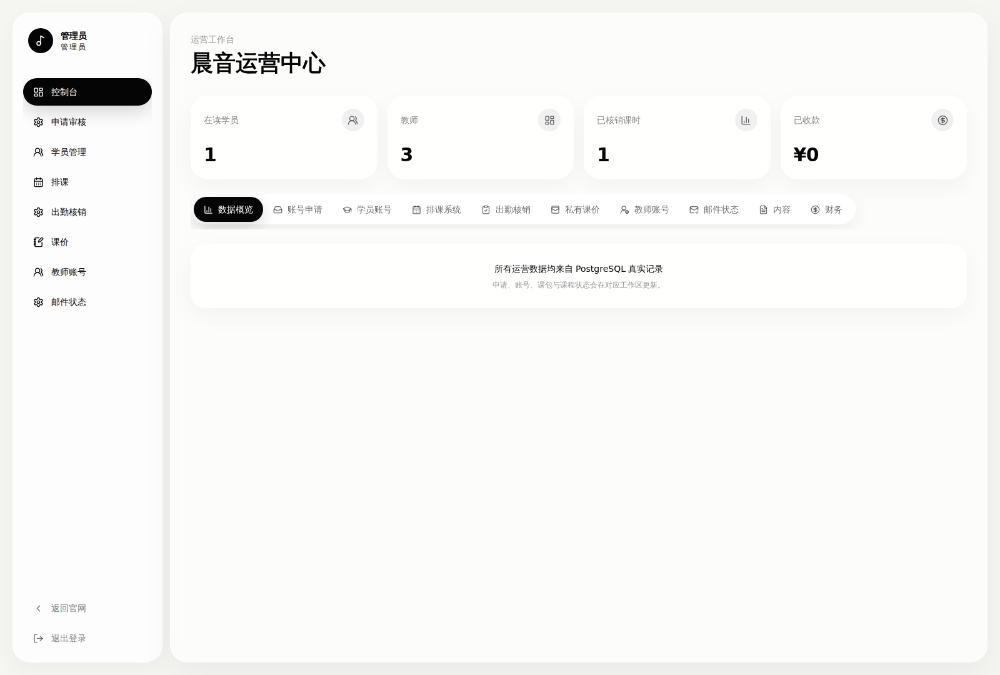
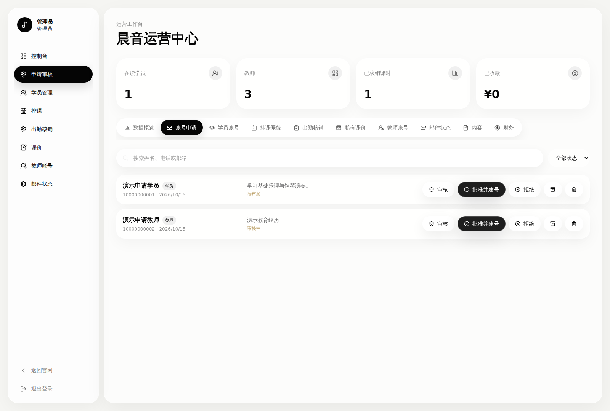
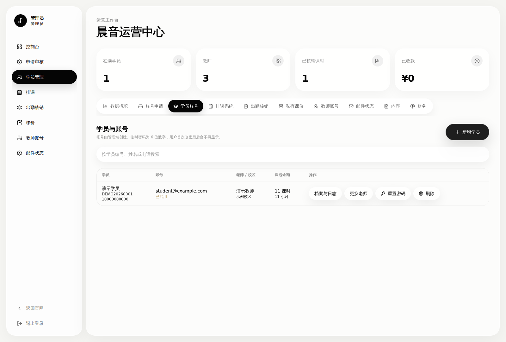
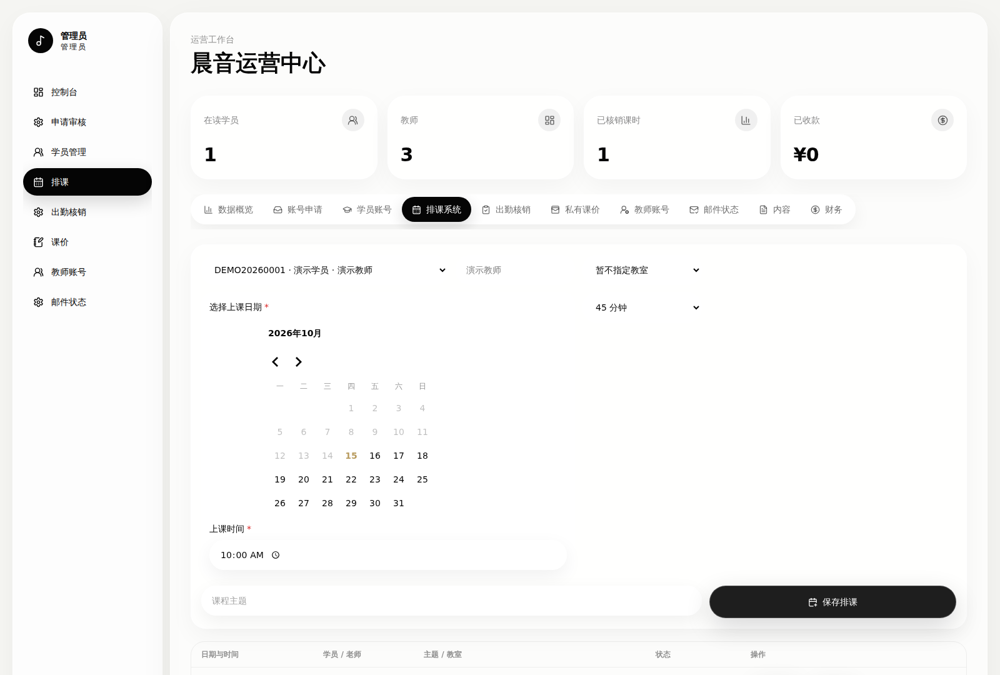
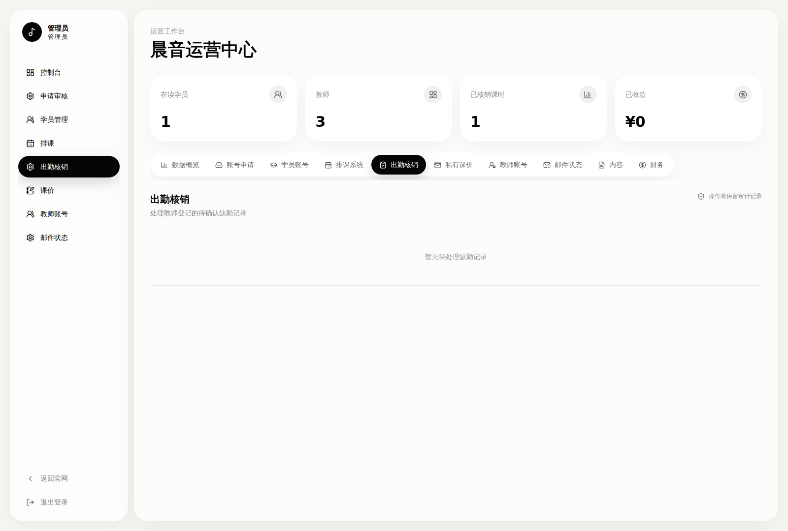
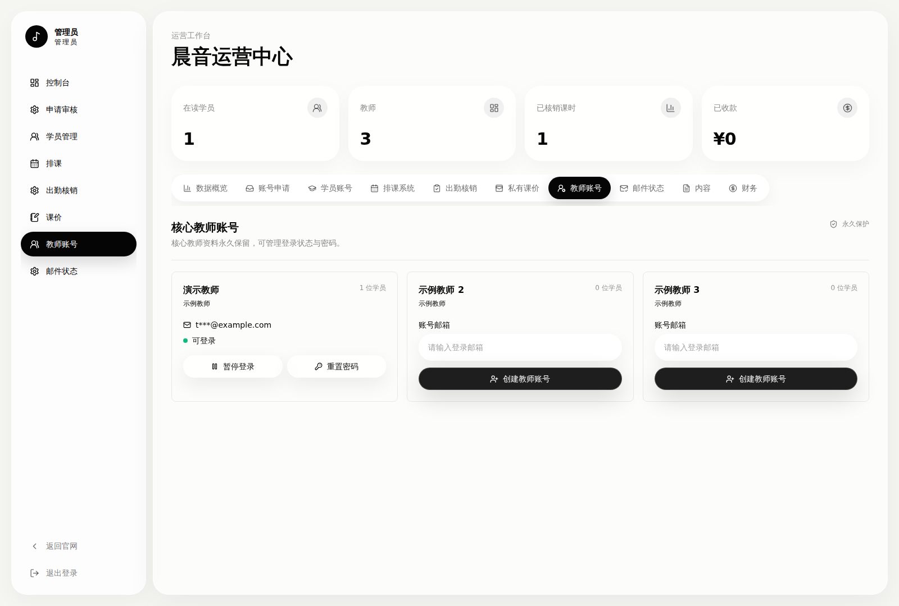
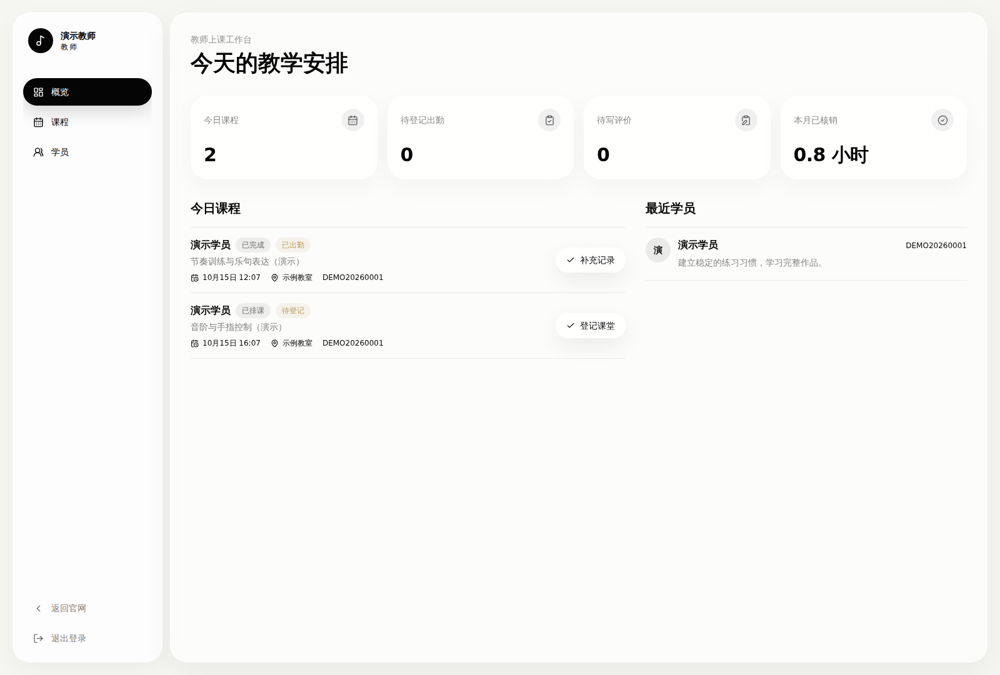
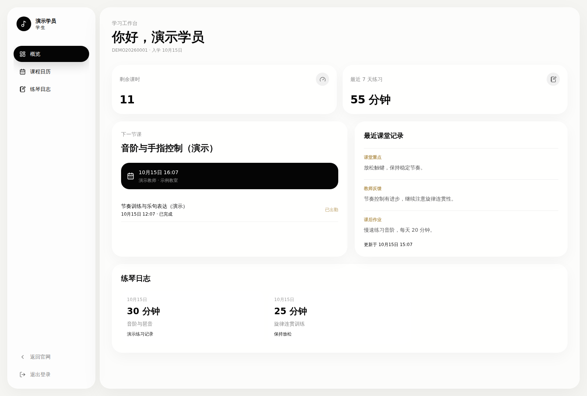
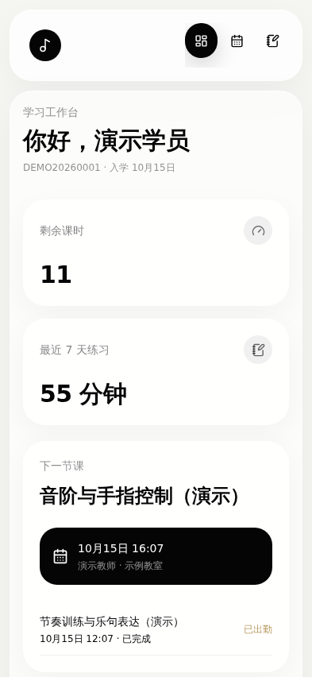

# 登录三端合一教学后台管理系统

覆盖管理员、教师、学员三端的统一登录与教学管理系统，MIT 开源。使用独立数据库与虚构演示档案运行，不依赖原网站、原 Vercel 项目或编辑器。

## 实际界面预览

以下 10 张图片来自系统启动后的浏览器实际截图，使用虚构的演示账号和教学数据。桌面视口为 1600 × 1080，移动视口为 393 × 852；点击图片可查看原图。

### 统一登录

### 管理员工作台

| 数据概览 | 账号申请审核 |
| --- | --- |
|  |  |

| 学员档案与教师分配 | 日历排课 |
| --- | --- |
|  |  |

| 出勤核销 | 教师账号管理 |
| --- | --- |
|  |  |

### 教师与学员工作台

| 教师：课程安排与学员 | 学员：课时、课堂反馈与练习 |
| --- | --- |
|  |  |

### 移动端学员工作台

截图由 [可复现的浏览器流程](scripts/capture-previews.mjs)生成，[运行证据](docs/previews/evidence.json)记录了页面路径与视口。移动预览为 Chromium 视口检查，不代表真实 iPhone/Safari 性能测试。

## 包含内容

- 邮箱密码登录、JWT 会话、首次登录改密、退出、角色权限。
- 管理数据概览、申请审核、学员档案与教师分配、课时包。
- 排课、出勤登记/核销、课堂反馈、课时流水、教师与学员工作台。
- 核心教师账号维护，临时密码通知与受控查看。
- React Email 模板、可选 Resend 发送、签名 Webhook 和邮件状态。
- 微信小程序认证/门户/通知 API、可选 S3/R2 上传。
- PostgreSQL/Prisma 模型、13 个迁移、审计、中英日路由。

**范围**：统一登录、后台管理界面与业务接口。官网宣传页、真实师资照片/简介、Three.js、液态玻璃、真实账号、数据库记录、历史 Git、Vercel 配置与密钥均不包含。小程序内容 API 返回空白示例结构；不包含小程序客户端。支付/日历字段不代表完整集成。

## 环境与启动

需要 Node.js 22+、npm、你自己的 PostgreSQL 16+ 空数据库。Redis 可选；多实例正式部署必须有共享限流存储。

1. `npm ci`。
2. 复制 `.env.example` 为 `.env`，填写你自己的空测试库 DATABASE_URL，不要用原网站数据库。
3. 分别运行两次下面命令，生成两个不同的密钥，填入 AUTH_SECRET 与 TEMPORARY_PASSWORD_ENCRYPTION_KEY：

   `node -e "console.log(require('node:crypto').randomBytes(32).toString('base64'))"`

4. `npm run db:migrate`。
5. 在 .env 设置自己的 ADMIN_SEED_EMAIL、至少 12 字符的 ADMIN_SEED_PASSWORD，将 CONFIRM_DEMO_SEED 设为 create-demo-in-empty-database。
6. `npm run db:seed`。脚本拒绝已有用户/校区/教师的数据库，仅创建管理员及虚构档案，无默认密码、不打印密码。
7. `npm run dev`，打开 http://localhost:3000/zh/login 。
8. 用第 5 步自行设置的账号密码登录，勿提交 .env。

其他语言：/en/login、/ja/login。初始教师档案不绑定账号，可在管理端教师账号面板创建。

构建 `npm run build`，运行 `npm start`。构建不自动执行迁移，部署迁移须单独审查。本地默认只监听 127.0.0.1。

## 可选服务

| 配置 | 用途 |
| --- | --- |
| RESEND_API_KEY + MAIL_FROM | 邮件发送；使用自己的已验证域名 |
| RESEND_WEBHOOK_SECRET | /api/webhooks/resend 签名校验 |
| BOOKING_NOTIFY_EMAIL | 你自己的内部通知收件人 |
| REDIS_URL | 共享登录失败计数 |
| S3_* | 你自己的存储 |
| WECHAT_* | 你自己的小程序账号、模板和密钥 |

未配置邮件不会连接原网站服务。微信模板 ID/字段映射需自行配置。.env.example 的 Cloudflare 值是公开测试钥匙，正式部署必须更换。数据库保存与通知不是同一事务，需检查通知状态。

## 检查与文档

`npm run typecheck` · `npm run lint` · `npm test` · `npm run build`

[实际验证记录](docs/验证记录.md) · [路由清单](docs/路由清单.md) · [系统说明](docs/系统说明.md) · [整理记录](docs/开源整理记录.md) · [安全限制](SECURITY.md) · [MIT License](LICENSE)

主要代码：src/app/api、src/app/[locale]、src/lib、src/components/dashboard、src/emails、prisma、tests。

本仓库提供教学管理系统的完整后台代码，不是已完成安全认证的通用认证框架。正式使用前阅读 SECURITY.md。此仓库发布不会自动改变原网站。
